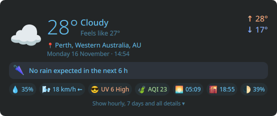
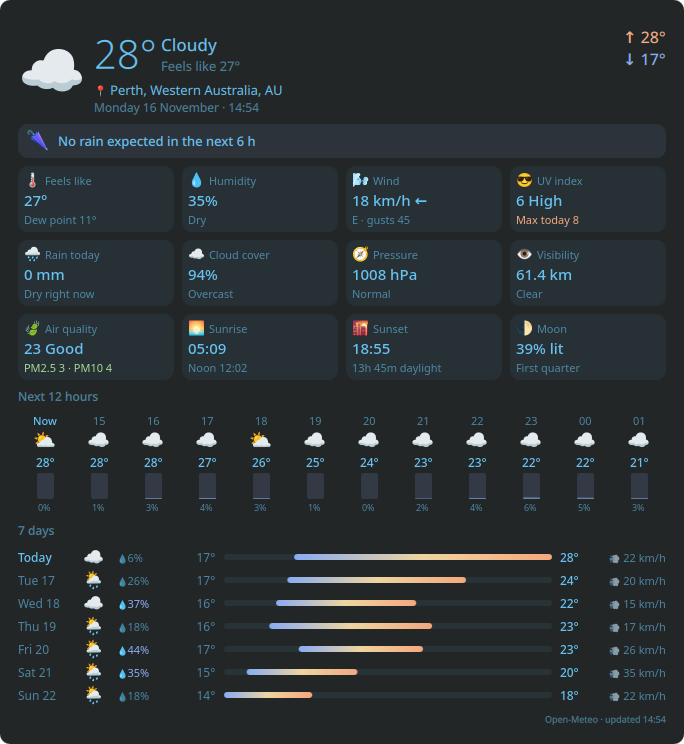

<div align="center">

# 🌅 Sky Line

**The whole day at a glance, with the weather where you are in it.**

A KDE Plasma 6 panel widget: today's 24 hours spread across your panel in sky colours,
sunrise and sunset marked, and the weather riding the line at the current time.
Click it for the forecast.

[](https://github.com/jesperdote/plasma-sky-line/releases/latest)
[](https://github.com/jesperdote/plasma-sky-line/releases)
[](https://kde.org/plasma-desktop/)
[](LICENSE)
[](https://open-meteo.com/)


</div>

---

## Contents

- [Features](#-features)
- [Screenshots](#-screenshots)
- [Install](#-install)
- [Location](#-location)
- [Settings](#%EF%B8%8F-settings)
- [Data sources and privacy](#-data-sources-and-privacy)
- [FAQ](#-faq)
- [Changelog and releasing](#-changelog-and-releasing)
- [Credits](#-credits)
- [License](#-license)

---

## ✨ Features

### On the panel

| | |
|---|---|
| 🌈 **Sky-coloured timeline** | A line from 00 to 24 coloured like the sky: night, dawn pink, day blue, dusk lilac. Daylight hours are drawn thicker. |
| 🌅 **Sunrise and sunset** | ↑ and ↓ times sit right on the scale, worked out for your location. |
| ⛅ **Weather at the current time** | A dot marks *now*; above it, an emoji for the weather right now: sun, clouds, fog, drizzle, rain, snow or thunderstorm. |
| 🌙 **Moon on clear nights** | When the sky is clear after dark, the icon becomes tonight's moon phase. |
| 🕐 **Time and temperature** | Optionally beside the icon, or turn both off for just the icon. |
| 📏 **Fills the gap** | It stretches to the space it's given, so it suits an empty part of a panel. |

### Click it: the weather popup

A solid card with two levels of detail.

**Summary** (default)

- Big weather icon, temperature, conditions, feels-like, today's high ↑ and low ↓
- 📍 Place name, date and time
- ☔ Rain outlook for the next 6 hours: *"Up to 48% chance of rain by 15:00"*
- Chips: 💧 humidity · 🌬️ wind with direction arrow · 😎 UV level · 🍃 air quality · 🌅 sunrise · 🌇 sunset · 🌓 moon

**Full details** (click *Show hourly, 7 days and all details*, or turn on the setting)

| Tile | Shows |
|---|---|
| 🌡️ Feels like | Apparent temperature and dew point |
| 💧 Humidity | Relative humidity: dry, comfortable or muggy |
| 🌬️ Wind | Speed, direction (arrow and compass point) and gusts |
| 😎 UV index | Now, colour-coded WHO level, and today's maximum |
| 🌧️ Rain today | Today's total and the current rate |
| ☁️ Cloud cover | Percentage: clear, some clouds or overcast |
| 🧭 Pressure | Sea-level pressure: low, normal or high |
| 👁️ Visibility | Distance: clear, hazy or poor |
| 🍃 Air quality | US AQI with colour-coded level, PM2.5 and PM10 |
| 🌅 Sunrise | Time, and solar noon |
| 🌇 Sunset | Time, and the length of daylight |
| 🌓 Moon | Phase name and how much is lit |

Plus:

- **Next 12 hours:** icon, temperature and a rain-chance bar for each hour (night hours get a moon)
- **7 days:** icon, rain chance, a low–high bar on the week's own temperature scale (cool blue to
  warm orange), and the day's strongest wind

---

## 📸 Screenshots

<div align="center">

**On the panel**


**Click: the summary**



**Show all details: the full card**



<sub>Screenshots show Perth, Western Australia.</sub>

</div>

---

## 📦 Install

> Needs **KDE Plasma 6**. No extra packages, no API keys.

### From the KDE Store

Right-click the panel → **Add Widgets…** → **Get New Widgets…** → **Download New Plasma Widgets**,
search for **Sky Line** and click **Install**.

### From a release

Download `com.github.jesperdote.skyline.plasmoid` from the
[latest release](https://github.com/jesperdote/plasma-sky-line/releases/latest), then either use
**Add Widgets… → Get New Widgets… → Install Widget From Local File…**, or:

```bash
kpackagetool6 -t Plasma/Applet -i com.github.jesperdote.skyline.plasmoid      # first install
kpackagetool6 -t Plasma/Applet -u com.github.jesperdote.skyline.plasmoid      # upgrade
```

### From source

```bash
git clone https://github.com/jesperdote/plasma-sky-line.git
kpackagetool6 -t Plasma/Applet -i plasma-sky-line/package
```

Then right-click the panel → **Add Widgets…**, search for **Sky Line** and drag it onto the panel.
It looks best in a wide, empty stretch of a horizontal panel.

> **Upgrading?** Plasma keeps the old version loaded until it restarts:
> `systemctl --user restart plasma-plasmashell` (or log out and back in).

---

## 📍 Location

Right-click → **Configure Sky Line…** → **Location**. There are two ways to set it:

1. **Fixed coordinates:** your latitude and longitude in decimal degrees, north and east
   positive (e.g. `-31.95`, `115.86` for Perth). Find yours at
   [latlong.net](https://www.latlong.net/).
2. **A location command:** any command that prints `lat,lon`, for a location that follows you
   (from a geolocation script, GeoClue, a phone sync…). It runs at start and then once an hour,
   and wins over the fixed coordinates. It may add a place name after a `|`:

   ```text
   -31.9523,115.8613|Perth
   ```

   Without a place name, the popup looks one up (see below).

---

## ⚙️ Settings

Right-click → **Configure Sky Line…** → **Appearance**:

| Setting | Options |
|---|---|
| **Beside the weather icon** | Current time and/or temperature; turn both off for just the icon |
| **Weather popup** | A click shows the summary (default) or the full details straight away |
| **Clock** | 24-hour (`08:45`) or 12-hour (`8:45 AM`, hour labels like `8a`, `12p`) |
| **Temperature** | °C or °F (°F also switches wind to mph, rain to inches and visibility to miles) |
| **Scale** | Sunrise/sunset times on or off · hour labels every 1, 2, 3 or 6 hours · fade the hours already past |
| **Sizes** | Weather icon (or *Fit*), hour labels, time/temperature text, line thickness |

---

## 🔒 Data sources and privacy

Sky Line has no account, no API key and no tracking. It makes these requests, all over HTTPS,
and sends only your coordinates (rounded to 4 decimals, about 10 m):

| What | Service | How often |
|---|---|---|
| Current weather, 24 hours, 7 days | [Open-Meteo](https://open-meteo.com/) forecast API | Every 15 minutes |
| Air quality (US AQI, PM2.5, PM10) | [Open-Meteo](https://open-meteo.com/en/docs/air-quality-api) air-quality API | Every 15 minutes |
| Place name | [BigDataCloud](https://www.bigdatacloud.com/) free reverse geocoding | Only when you move about 1 km, and never if your location command gives a name |

Sunrise, sunset and the moon phase are calculated on your computer.

---

## ❓ FAQ

<details>
<summary><b>The line is there but there's no weather icon.</b></summary>

Set a location (see [Location](#-location)). With latitude and longitude both 0, Sky Line shows
*"set a location in the settings"*. If you use a location command, run it in a terminal and check
that it prints `lat,lon`.
</details>

<details>
<summary><b>The weather icon looks too small or too big.</b></summary>

**Appearance → Sizes → Weather icon.** *Fit* uses the height above the line; a fixed size larger
than that spills into the panel's margin.
</details>

<details>
<summary><b>The emoji show as black-and-white symbols or boxes.</b></summary>

Install a colour emoji font, for example `noto-fonts-emoji` (Arch), `fonts-noto-color-emoji`
(Debian/Ubuntu) or `google-noto-emoji-color-fonts` (Fedora).
</details>

<details>
<summary><b>The moon phase is a few hours off.</b></summary>

It uses the mean length of a lunar month, which is accurate to within a few hours of the exact
phase change. Fine for a glance, not for astronomy.
</details>

<details>
<summary><b>Does it use much CPU or GPU?</b></summary>

No. It redraws once every 30 seconds and fetches the weather every 15 minutes; in a measured
A/B test the difference to an empty panel was within noise.
</details>

<details>
<summary><b>Can I use it on a vertical panel?</b></summary>

It's designed for a wide horizontal panel. On a vertical panel the 24 hours don't have room.
</details>

---

## 📝 Changelog and releasing

What changed in each version: **[CHANGELOG.md](CHANGELOG.md)**.

To release a new version:

1. Set `"Version"` in `package/metadata.json` (e.g. `1.3.0`).
2. Add a `## [1.3.0] - YYYY-MM-DD` section to `CHANGELOG.md` (Added / Changed / Fixed).
3. Commit, then `git tag v1.3.0 && git push && git push --tags`.

The [release workflow](.github/workflows/release.yml) checks that the tag matches
`metadata.json`, builds the `.plasmoid` and publishes a GitHub release with that changelog
section as its notes.

Bug reports and ideas are welcome in [Issues](https://github.com/jesperdote/plasma-sky-line/issues).

---

## 🙏 Credits

- Sunrise and sunset maths follow [SunCalc](https://github.com/mourner/suncalc) by Vladimir
  Agafonkin (BSD-2-Clause), based on [aa.quae.nl](https://aa.quae.nl/en/reken/zonpositie.html).
- Weather and air quality by [Open-Meteo](https://open-meteo.com/) (CC BY 4.0).
- Reverse geocoding by [BigDataCloud](https://www.bigdatacloud.com/).
- Sky colours from the [Catppuccin](https://github.com/catppuccin/catppuccin) Macchiato palette.

## 📄 License

[GPL-3.0-or-later](LICENSE) © Jesper Dote
