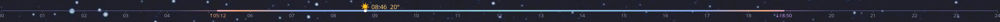

# Sky Line

Today's 24 hours spread across the panel, with the weather sitting at the current time.



- A line runs from 00 to 24, coloured like the sky (night, dawn pink, day blue, dusk lilac);
  daylight hours are thicker. A label for every hour.
- Sunrise (↑) and sunset (↓) times sit on the scale.
- A dot marks the current time, and above it an emoji shows the weather right now: sun, clouds,
  fog, drizzle, rain, snow or thunderstorm. On clear nights it shows the moon in tonight's phase.
  The time and temperature sit beside it.
- **Click** the widget for a weather summary: conditions, feels-like, high/low, place, the rain
  outlook, and chips for humidity, wind, UV, air quality, sunrise, sunset and the moon.
  **Show all details** in it (or the *full details* setting) opens the full card:
  - now: temperature, feels-like, conditions, today's high and low, place name, date;
  - the rain outlook for the next 6 hours ("Up to 48% chance of rain by 15:00");
  - tiles for feels-like and dew point, humidity, wind (speed, direction, gusts), UV index,
    rain today, cloud cover, pressure, visibility, air quality (US AQI, PM2.5, PM10),
    sunrise, sunset and daylight, and the moon;
  - the next 12 hours (icon, temperature, rain chance bars);
  - 7 days (icon, rain chance, low-high range on the week's scale, max wind).

It fills the space it's given, so it suits an empty stretch of a panel.

## Location

Right-click → **Configure Sky Line…** and enter your latitude and longitude (decimal degrees, north
and east positive). Or give a command that prints `lat,lon` (for example from a geolocation script), optionally
followed by `|Place name`; it runs once an hour and wins over the fixed location. Without a place
name, the card looks one up with [BigDataCloud](https://www.bigdatacloud.com/)'s free reverse
geocoding (no key), only when the location moves by about a kilometre.

Weather comes from [Open-Meteo](https://open-meteo.com/) (free, no key), every 15 minutes: the
forecast API, and its air-quality API for the AQI tile. Sunrise and
sunset use the SunCalc formulas (Vladimir Agafonkin, BSD-2-Clause); the moon phase uses the mean
synodic month, so it can be a few hours off the exact phase change.

## Settings

Right-click → **Configure Sky Line…** → **Appearance**:

- **Beside the weather icon:** current time and/or temperature; turn both off for just the icon. Also whether a click shows the full weather details straight away instead of the summary.
- **Clock:** 24-hour (08:45) or 12-hour (8:45 AM; hour labels like 8a, 12p).
- **Temperature:** °C or °F.
- **Scale:** sunrise/sunset times on or off; hour labels every 1, 2, 3 or 6 hours; fade the hours already past.
- **Sizes:** weather icon (or *Fit*), hour labels, time/temperature, line thickness.

## Install

**From the KDE Store** (once it's listed): right-click the panel → **Add Widgets…** → **Get New Widgets…**
→ **Download New Plasma Widgets** and search for it.

**From a release:** download the `.plasmoid` file from the
[latest release](https://github.com/jesperdote/plasma-sky-line/releases/latest), then

```bash
kpackagetool6 -t Plasma/Applet -i com.github.jesperdote.skyline.plasmoid      # first install
kpackagetool6 -t Plasma/Applet -u com.github.jesperdote.skyline.plasmoid      # upgrade
```

**From source:**

```bash
git clone https://github.com/jesperdote/plasma-sky-line.git
kpackagetool6 -t Plasma/Applet -i plasma-sky-line/package
```

Then right-click the panel → **Add Widgets…** and search for it. Needs Plasma 6.

## License

[GPL-3.0-or-later](LICENSE).
